# Zombies Dark Ops Calling Cards

[Open the tracker](https://xieons-gaming-corner.github.io/bo7_tracker/) · [Wiki Home](https://github.com/Xieons-Gaming-Corner/bo7_tracker/wiki)

The Zombies Dark Ops Tracker is a manual checklist for community-documented Black Ops 7 Zombies calling-card challenges. It does not read your game account or automatically detect unlocks.

## Using the Checklist

1. Open the tracker and select Zombies Dark Ops Tracker.
2. Choose a map or mode, or leave All maps / modes selected.
3. Read the calling-card name, requirement, and any uncertainty notes.
4. Complete the requirement in-game and check off the entry.
5. Enable Show remaining only to focus on unfinished entries.

Viewing an image does not mark a challenge complete. Filters change the visible entries without clearing their checkmarks.

## Calling-Card Artwork

The artwork integration displays matching images above Dark Ops entries and adds Zombies Dark Ops Master artwork to the mastery section. Images scale to fit mobile and desktop layouts without cropping.

Artwork is supplied from the repository’s `assets/dark ops/` folder. These are presentation assets, not evidence that a challenge is unlocked or that its documented requirement is correct.

The expired beta entry has no matching image in the uploaded collection. Missing artwork does not prevent using a requirement or checkbox.

## Progress and Mastery

Dark Ops has its own checklist progress and mastery status, separate from relics, operator skins, toys, and Wrestling Belt progress. Completing entries in another tracker does not complete Dark Ops entries.

Use the app’s mastery status to follow its tracked qualifying challenge progress. The mastery artwork is a visual reference; displaying it does not mean your in-game account has earned it.

## Expired Beta Entry

Enable Include expired beta to display the historical beta challenge. It is optional and excluded from active checklist progress. Checking it off is only a manual record; it does not grant an expired reward.

## Verification Notes

- The checklist is community-maintained and is not independently verified against your account.
- A dagger (†) marks a provisional calling-card name.
- Chronomancer has conflicting documented requirements. Read the tracker notes and check current evidence before attempting it.
- Game updates can change requirements or challenge behavior. Follow current in-game information when references conflict.

The app links community references from Zombies Codex, Windows Central, and PCGamesN. Treat uncertainty notes as part of each entry, not as optional instructions.

## Resetting and Session Progress

Use Reset Dark Ops to clear this checklist. Other trackers keep their independent progress. Turn off Show remaining only if you need to find and uncheck a completed entry.

Checkmarks are session-only. Reloading or reopening the page clears progress. Separate tabs and devices do not share checkmarks, and progress does not sync with the game or Discord. Take a screenshot before leaving if you need a record.

## Support

Report an incorrect name, missing image, or outdated requirement with the affected card’s name and a screenshot where possible.

[Join Xieon’s Gaming Corner on Discord](https://discord.gg/Xieon)

Unofficial community tracker. Call of Duty artwork and game assets remain the property of their respective owners.

## Calling Card Images (alphabetical) :
Paste this under `## IMAGES`. Each card has its own heading and image, stacked **vertically**.

### Action Hero
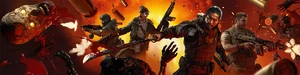

### Anathema
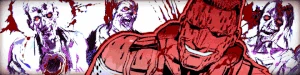

### Another Round

### Arachnid Enthusiast
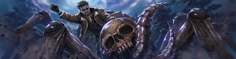

### Armed to the Teeth
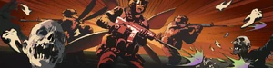

### Astronomical

### Blitzed

### Boss Rush
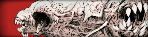

### Box Addict
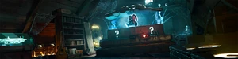

### Chronomancer
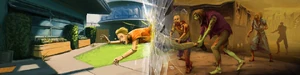

### Conqueror
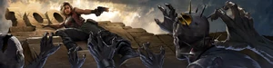

### Countdown
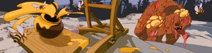

### Daily Tot
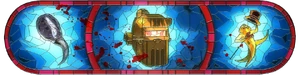

### Deicide
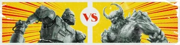

### Domineering
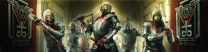

### Doomstick
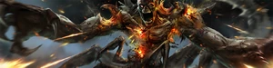

### Echoes
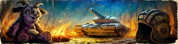

### Epidemic
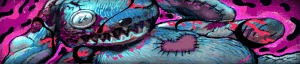

### Flushed for Cash
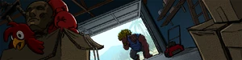

### Harbinger of Doom
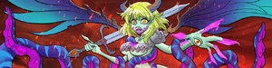

### Hard Mode
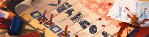

### Ingenuity
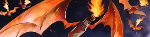

### Invincible
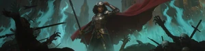

### Kaijuu Dig It!
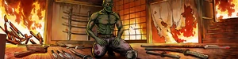

### Lucidity
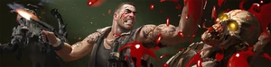

### Maneki Mecha
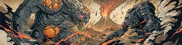

### Martial Artist
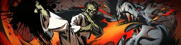

### Mythic Cynic
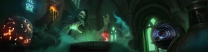

### Neutronomic
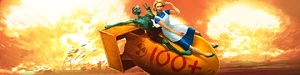

### New Main

### Ready for Publishing

### Relativity

### Reliquary
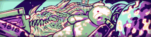

### Serious Monkey Business
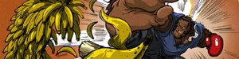

### Shogun
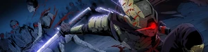

### Showboat
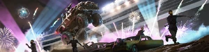

### Social Distancing
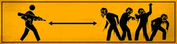

### The Bomba
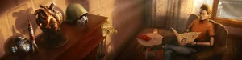

### The One

### The Reunion
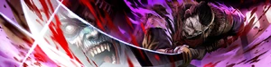

### The Usual, Please
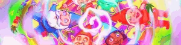

### Torchbearer
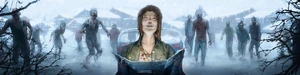

### Tutus Mortuorum
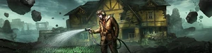

### Void Caller
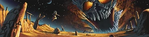

### Zombies Dark Ops Master
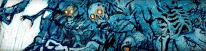

